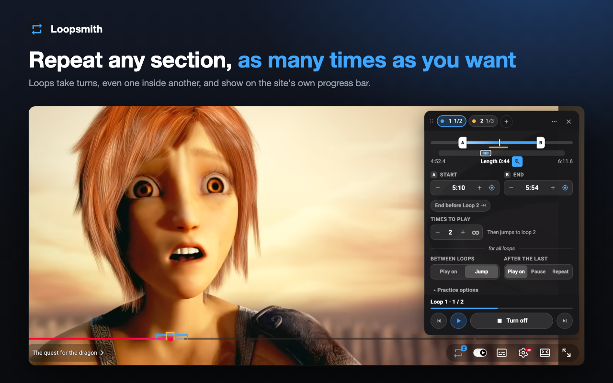

<p align="center">
  
</p>

<h1 align="center">Loopsmith</h1>

<p align="center">
  A-B loop for any song or video: repeat one or several sections, a chosen number of times or forever.
</p>

<p align="center">
  <a href="https://github.com/noahbds/loopsmith/actions/workflows/ci.yml"></a>
  <a href="LICENSE"></a>
</p>

<p align="center">
  
</p>

Made for practising (a guitar riff, the hard part of a song, a dance move, a language lesson) and
for keeping your favourite part of a song on repeat.

## Install

- **Chrome, Edge, Brave:** Chrome Web Store (in review)
- **Firefox:** Firefox Add-ons (in review)
- **From source:** see [Build](#build), or download the packages attached to each
  [release](https://github.com/noahbds/loopsmith/releases).

## What it does

- Set the start and end by dragging the A and B handles, typing a time (`1:23`, `90s`, `1m30s`), or
  grabbing the current position.
- Choose how many times a section plays (1 to 999) or forever.
- Zoom with the mouse wheel, snap loop edges to each other or to video chapters, place a loop
  right after the previous one, step a loop forward/back by its own length, halve/double it, or
  tap a key while playing to mark sections.
- Copy a link carrying your loops (`#loopsmith=…` plus `?t=`) to share sections with a student or
  bandmate without accounts or servers.
- Several loops per video or track, overlapping or nested; switch one off without deleting it.
- Loops take turns: a loop inside another one waits until the outer one is done. Between loops:
  play on or jump straight to the next one. After the last: play on, pause, play them all again
  (a number of rounds, or again and again), or go on to the next track or video.
- No loop until you make one: one click loops the whole video or track. Optionally, looping turns
  on by itself on media you already have loops for.
- Loops show on the site's own progress bar, are saved per video or track, and can be browsed,
  searched, exported and imported as JSON from the toolbar popup.
- Skip ahead without waiting: next / previous loop, skip a repetition, restart it, or jump to loop 1–9.
  Deleting loops can be undone.
- Shortcuts (all remappable in the popup, plus optional browser-wide shortcuts):
  <kbd>Shift</kbd>+<kbd>A</kbd> / <kbd>Shift</kbd>+<kbd>B</kbd> set start / end to now,
  <kbd>Shift</kbd>+<kbd>S</kbd> plays the selected loop, <kbd>Shift</kbd>+<kbd>R</kbd> turns looping
  on or off, <kbd>Shift</kbd>+<kbd>]</kbd> / <kbd>[</kbd> next / previous loop,
  <kbd>Shift</kbd>+<kbd>\</kbd> skips a repetition, <kbd>Shift</kbd>+<kbd>Z</kbd> restarts it,
  <kbd>Shift</kbd>+<kbd>J</kbd> / <kbd>L</kbd> steps the loop back / ahead by its length,
  <kbd>Shift</kbd>+<kbd>H</kbd> / <kbd>D</kbd> halves / doubles its length,
  <kbd>Shift</kbd>+<kbd>1</kbd>…<kbd>9</kbd> goes to that loop.

## Where it works

| | |
|---|---|
| **Built in** | YouTube, YouTube Music, Spotify, Apple Music, SoundCloud, Deezer, Tidal, Amazon Music, Bandcamp, Vimeo, Twitch (videos and clips), Bilibili, Dailymotion |
| **Any other site** | Click the toolbar button, then *Turn on for this site* (or *for every website*). Works with any HTML5 `<video>` / `<audio>`, including players built as web components. |
| **Local files** | Open an MP3/MP4 in the browser, click the toolbar button, and turn Loopsmith on for local `file://` media. |

Live streams can't be looped. Spotify needs a browser with DRM support (regular Chrome, Edge, Firefox).

## Privacy

No account, no analytics, no network requests. Loops are stored in your browser only, and
Loopsmith only runs on other sites after you turn it on for them. See [PRIVACY.md](PRIVACY.md).

## Build

Needs Node.js 20 or later.

```bash
npm ci
npm run build   # dist/chrome, dist/firefox, plus loopsmith-chrome.zip and loopsmith-firefox.xpi
```

- **Chrome / Edge / Brave:** `chrome://extensions` → Developer mode → *Load unpacked* → `dist/chrome`
- **Firefox:** `about:debugging` → This Firefox → *Load Temporary Add-on* → `dist/firefox/manifest.json`

## Contributing

Bug reports, site requests and pull requests are welcome. Start with [CONTRIBUTING.md](CONTRIBUTING.md);
security issues go through [SECURITY.md](SECURITY.md). Changes are listed in [CHANGELOG.md](CHANGELOG.md).

## License

[MIT](LICENSE). Loopsmith is not affiliated with any of the sites it works on.
